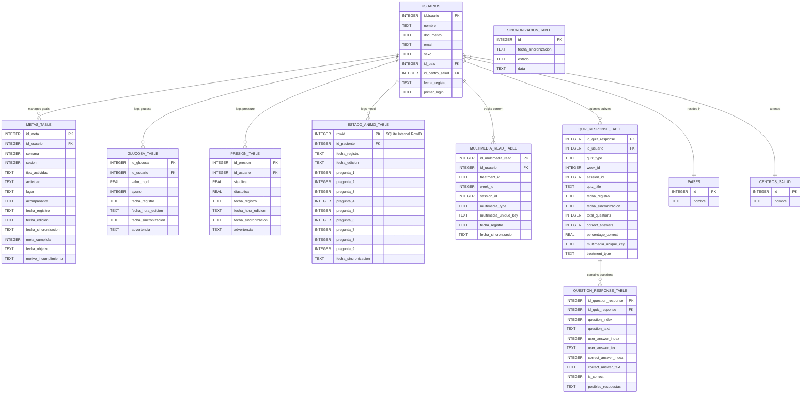

# Local Database Entity-Relationship Diagram (DER)

This file contains the Mermaid diagram for the `colmaApp` local SQLite database. You can visualize this diagram by pasting the code block below into the [Mermaid Live Editor](https://mermaid.live/) or by using a Markdown viewer that supports Mermaid.

